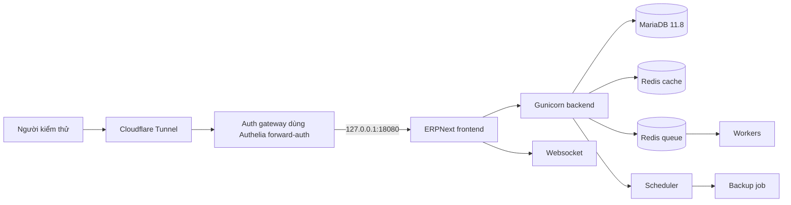

# Kiến trúc ERPNext staging trên runtime 1.243

## Mục đích và phạm vi

Thiết kế này chuẩn bị một staging cô lập trên runtime 1.243. Nó chưa cấp quyền triển khai, chưa tạo site, chưa thay đổi reverse proxy và không đụng các PostgreSQL/service hiện hữu của project khác.

## Quyết định phiên bản

- ERPNext `v16.60.0`, source commit `886ab6ae187244e7f1b852393384ab6019d56264`.
- Frappe `v16.60.2`, source commit `2df0425571ebbaed878eabc3edc5b7e7c3327ae0`. ERPNext yêu cầu Frappe `>=16.60.0,<17.0.0`.
- Image `frappe/erpnext:v16.60.0` pin theo OCI index digest `sha256:3847baba...`.
- MariaDB `11.8` và Redis `8.6-alpine` đều pin theo digest trong `deploy/staging/compose.yaml`.

Source project hiện tại ở commit `34b3f4b2bb88a1f6c25dadcd92041e82f30ad42a`, là ERPNext `17.0.0-dev` và yêu cầu Frappe 17. Không dùng checkout này làm application image cho staging v16; deployment dùng image upstream đã pin. Nếu phát triển custom app v16, phải tạo worktree/branch từ tag v16 tương ứng thay vì sửa core trên nhánh develop.

## Lựa chọn cơ sở dữ liệu

Chọn MariaDB 11.8 cho deployment candidate. PostgreSQL chỉ nên là một nhánh đánh giá riêng:

- Frappe v16 có backend PostgreSQL và test matrix PostgreSQL.
- ERPNext v16 có workflow `server-tests-postgres.yml` và các nhánh xử lý dialect PostgreSQL.
- `frappe_docker` cung cấp production override PostgreSQL 15.17.
- Tuy nhiên, chính lệnh `bench new-site --db-type postgres` của Frappe v16.60.2 cảnh báo support đang phát triển và được coi là experimental. MariaDB là mặc định upstream, có workflow CI chính và độ phủ vận hành lớn hơn.

Vì vậy ưu tiên PostgreSQL của T-166 không đủ để dùng làm baseline an toàn. Nếu cần đánh giá PostgreSQL, tạo stack/site tách biệt và không nâng thành production trước khi test đủ luồng mua hàng, kho, kế toán, migration và backup/restore.

Database và Redis chỉ nằm trên Docker network `internal`; không publish cổng ra host. Không tái sử dụng PostgreSQL đang nghe trên runtime vì chưa xác định ownership và backup policy của các service đó.

## Luồng truy cập

Domain được cấp là `https://erpnext.proj.vn`. Port origin đề xuất là `127.0.0.1:18080`; audit không thấy listener tại port này.

Giai đoạn đầu dùng hai lớp đăng nhập độc lập:

1. Authelia xác thực LDAP ở lớp ingress.
2. ERPNext tiếp tục yêu cầu tài khoản/phiên đăng nhập riêng.

Authelia là authorization server/forward-auth service, không tự proxy request tới ERPNext. Vì tạm thời không dùng Caddy, Cloudflare Tunnel phải trỏ tới một auth gateway khác có hỗ trợ Authelia forward-auth, ví dụ Nginx/Traefik hiện hữu hoặc một Nginx gateway được cấp ownership riêng. Không trỏ tunnel thẳng tới Authelia rồi kỳ vọng Authelia chuyển tiếp request.

Việc không có IP tĩnh không cản Caddy hoặc Nginx nằm sau Cloudflare Tunnel: tunnel chủ động kết nối outbound và có thể gọi origin loopback. Tuy nhiên quyết định hiện tại vẫn là chưa dùng Caddy; cấu hình auth gateway cụ thể phải được xác nhận theo service ownership trước deploy.

ERPNext được xem là external app của N9. RBAC N9/NEM82 không được giả định là internal-app RBAC hoặc tự động đồng bộ thành ERPNext roles. Giai đoạn hai mới thiết kế identity linking/SSO và mapping group/role; hiện tại hai lớp giữ credential, session và logout tách biệt.

## Lưu trữ và sizing ban đầu

- Named volumes: `sites`, `db-data`, `redis-queue-data`.
- Baseline: 2 Gunicorn workers x 4 threads; đo tải trước khi tăng.
- Runtime có 8 CPU, 15 GiB RAM, khoảng 9 GiB available tại thời điểm audit.
- `/home` còn khoảng 40 GiB và đã dùng 83%. Cần reserve tối thiểu cho images, database, file uploads và hai bản backup; thiết lập cảnh báo dung lượng trước deploy.
- Backup đầy đủ chạy hàng tuần, giữ đề xuất 8 tuần (`BACKUP_RETENTION_DAYS=56`) và phải sao chép ra storage ngoài Docker host.

## MCP và CLI

Frappe v16 cung cấp MCP tại `/api/v2/mcp`, bật bằng `System Settings.enable_mcp`. Registry native gồm cả read, create, update, delete và gọi whitelisted method; mọi thao tác dùng Frappe permissions. Vì vậy:

- Không dùng Administrator cho agent.
- Tạo System User riêng theo vai trò và chỉ cấp DocType permissions cần thiết.
- Production profile của `frappectl` phải read-only; staging writable chỉ cho Engineer và vẫn chặn submit/cancel/delete/payment/stock posting bằng role/workflow phía server.
- Thực hiện positive và negative permission tests sau khi site có credential. Prompt không phải security boundary.
- Role matrix triển khai nằm tại `docs/security/mcp-role-matrix.md`.
