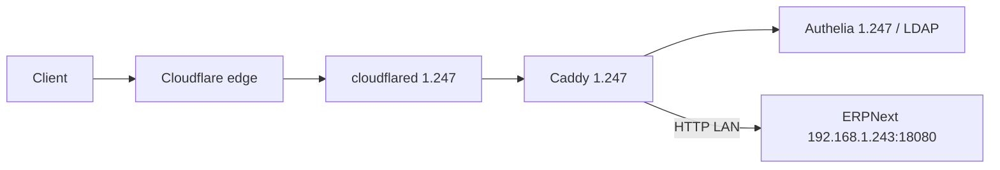

# Contract ingress N9 1.247 cho ERPNext 1.243

## Phạm vi

ERPNext chạy trên `192.168.1.243`; Cloudflare Tunnel, Caddy và Authelia/LDAP dùng service chung trên `192.168.1.247`. File này là contract/handoff reviewable, không cấp quyền cho agent 1.243 sửa runtime 1.247.

Read-only audit ngày 2026-11-20 xác minh:

- `192.168.1.247:80` và `:443` mở trong LAN; `:9091` không expose.
- `https://auth.proj.vn` trả Authelia login và HTTP 200.
- Gọi trực tiếp `192.168.1.247:443` với SNI `auth.proj.vn` trả header `via: 1.1 Caddy`; certificate origin do Caddy Local Authority cấp.
- `/api/verify` trả 401 khi chưa đăng nhập, phù hợp forward-auth behavior.
- `/api/authz/forward-auth` với forwarded headers của `erpnext.proj.vn` trả 302 tới Authelia login khi chưa có session, xác nhận endpoint tích hợp đang hoạt động.
- DNS authoritative cho `erpnext.proj.vn` hiện trả NXDOMAIN; kết quả không có dấu chấm từ resolver local bị search suffix thành domain khác và không được coi là DNS hợp lệ.

## Luồng mục tiêu

Caddy dùng `forward_auth` trước `reverse_proxy`. Sau khi Authelia cho phép, ERPNext vẫn hiển thị login riêng ở giai đoạn hai lớp. Không truyền LDAP password hoặc Authelia session vào ERPNext.

## Thay đổi phía 1.243

- Publish frontend tại `192.168.1.243:18080`, không publish MariaDB/Redis/backend.
- Tin cậy real-IP duy nhất từ `192.168.1.247` qua `AUTH_GATEWAY_IP`.
- Host firewall phải chỉ cho `192.168.1.247` truy cập TCP/18080. Audit hiện không xác minh được firewall rule, nên không start stack trước khi ACL được áp dụng.
- `firewalld` và `nftables` service hiện inactive trên 1.243. Vì Docker published ports đi qua `DOCKER-USER`, ACL phải được cài ở chain này và có cơ chế persist/reload được owner duyệt.

## Handoff phía 1.247

Owner 1.247 cần review và áp dụng hai fragment trong `deploy/staging/n9-1247/` theo cấu trúc service hiện hữu:

1. Tạo DNS/tunnel hostname `erpnext.proj.vn` và route vào shared Caddy.
2. Thêm Caddy site sử dụng Authelia internal upstream hiện hữu và reverse proxy `192.168.1.243:18080`.
3. Xác nhận websocket, `Host`, `X-Forwarded-For`, `X-Forwarded-Proto` được giữ đúng.
4. Không expose Authelia 9091 ra LAN; Caddy gọi qua network/internal endpoint hiện hữu.

`AUTHELIA_INTERNAL_UPSTREAM` cố ý không hard-code vì endpoint/service name thuộc cấu hình riêng của 1.247 và không được đọc hoặc suy diễn từ runtime 1.243.

## Kiểm tra chấp nhận

1. DNS `erpnext.proj.vn` resolve qua Cloudflare và TLS public hợp lệ.
2. Anonymous request bị chuyển tới Authelia; LDAP login thành công mới tới ERPNext.
3. ERPNext login vẫn là lớp thứ hai; logout từng lớp được ghi rõ cho người dùng.
4. Request trực tiếp từ máy LAN khác tới `192.168.1.243:18080` bị firewall từ chối.
5. Websocket, upload và background job UI hoạt động qua tunnel.
